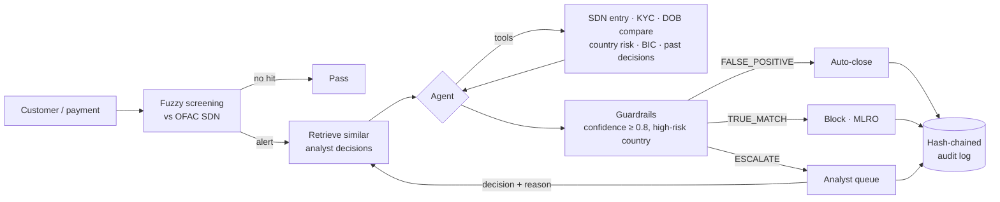

# Mini-Iris: LLM adjudication of sanctions screening alerts

End-to-end prototype of an AI agent that resolves sanctions-screening alerts against a written bank policy, inspired by Silent Eight's Iris.

**Sanctions screening produces thousands of alerts, and over 90% of them are false positives.** Mini-Iris is an agentic system that investigates each alert the way an analyst would, decides against the bank's written policy, explains why, escalates what it is unsure about, learns from analysts' decisions and records everything in a tamper-evident audit log.

## Headline results

Stratified evaluation set of 24 alerts with known ground truth (8 real sanctioned persons, 12 lookalikes, 4 coincidental hits), Claude Haiku 5.5, tool-using agent:

| | |
|---|---|
| Sanctioned persons let through | **0 / 8** |
| Sanctioned persons blocked automatically | **8 / 8** |
| False positives closed without a human | **14 / 16 (88%)** |
| Agreement with the written policy | **100%** |
| Escalated to a human | 8% |
| Cost / latency per alert | **$0.001 / 7 s** |

Full comparison of three agent architectures is in [Evaluation harness](#evaluation-harness).

## What's inside

- **Tool-using agent** (Anthropic tool-use loop, 7 investigation tools, max 8 rounds) with code-enforced guardrails: confidence threshold, high-risk-country rule, malformed output → escalate.
- **Multi-agent mode**: Investigator → Adjudicator → Reviewer with separation of duties and a four-eyes revision loop.
- **Evaluation harness**: fixed stratified sample, deterministic policy oracle, metrics where *missed sanctioned person* is the hard constraint, run history with prompt/policy version hashes. It caught a real bug (see below).
- **Analyst feedback loop**: analysts resolve the escalation queue; their decisions are retrieved as precedents for similar future alerts.
- **Compliance-grade audit trail**: SHA-256 hash chain over every decision, including the full investigation trace, model, policy version and cost.
- **Two screening flows**: customers (KYC) and payments (with its own policy, BIC country lookup and high-risk jurisdictions).

Stack: Python, pandas, RapidFuzz, Anthropic API (Claude Haiku 5.5), Streamlit, OFAC SDN data.



## Pipeline

1. **Sanctions list**: OFAC SDN list (individuals + aliases, ~16k names) parsed and cleaned. `01_explore_sdn.ipynb`
2. **Customers**: 5,220 synthetic customers (Faker), incl. 20 real SDN matches and 200 lookalikes, each with a ground-truth label. `02_customers.ipynb`
3. **Screening**: fuzzy name matching (RapidFuzz `token_sort_ratio` ≥ 85 in the notebook, `token_set_ratio` in the app) produces 249 alerts, ~91% of them false positives, which is the problem real banks face. `03_screening.ipynb`
4. **Agent**: Claude reads each alert plus the bank policy (`policy/sanctions_policy.md`) and returns structured JSON: decision, rule applied, evidence per attribute, confidence. `04_agent.ipynb` (first, single-call version; the app now uses the tool-using agent below)
5. **Audit log**: every decision stored in a SHA-256 hash chain; any later edit is detectable. `05_audit.ipynb`
6. **Dashboard**: Streamlit view of screening funnel, agent metrics, confusion matrix and per-alert rationale. `app/dashboard.py`

## Agentic investigation (tool use)

In the app the agent is not a single prompt. `app/iris_agent.py` runs an Anthropic **tool-use loop**: the agent gets only the alert and a set of tools, decides which evidence it needs, calls tools over several rounds and finishes by calling `submit_decision`.

| Tool | What it returns |
|---|---|
| `get_sdn_entry` | Full SDN record: aliases, DOB, nationality, passport, program, remarks |
| `get_customer` | Bank KYC data for a customer id (ground-truth label deliberately withheld) |
| `compare_dates` | Deterministic DOB comparison (handles `circa`, ranges, mixed formats), so the model never does date arithmetic in its head |
| `search_sdn` | Fuzzy search of any name against the SDN list |
| `check_country_risk` | High-risk / sanctioned jurisdiction check |
| `lookup_bic` | Bank country from the BIC/SWIFT code |
| `get_past_decisions` | Earlier decisions and analyst overrides for the same SDN entry or a similar name |
| `submit_decision` | Terminal tool: decision, rule, rationale, cited evidence, per-factor scores, confidence |

Guardrails around the loop: max 8 rounds, unknown tools / tool errors are returned to the model as errors, a missing or malformed decision becomes ESCALATE, and the confidence threshold and high-risk-country rule are enforced in code after the model decides. Every step (tool, arguments, result) plus token usage and cost is shown in the UI as an investigation trace and stored in the hash-chained audit log.

## Multi-agent mode: Investigator → Adjudicator → Reviewer

Besides the single tool-using agent, the app can run a **team of three agents** with separated duties (pick "Zespół agentów" on pages 1 and 2, or `--mode multi` in the evaluation):

1. **Investigator** has the tools but is forbidden to decide. It returns an evidence dossier (`submit_findings`): facts with the tool each came from, a summary and open questions.
2. **Adjudicator** has no tools. It decides only from the dossier and the policy (`submit_decision`), so it cannot invent evidence.
3. **Reviewer** is a four-eyes check (`submit_review`): does the rule fit the facts, is every cited fact in the dossier, is a TRUE_MATCH based on more than the name, should missing data have forced ESCALATE, is the confidence justified. It either approves or sends the case back: missing evidence goes back to the Investigator, decision errors go back to the Adjudicator with the reviewer's comments.

At most 2 revision rounds; if the Reviewer still does not approve, the case is escalated to a human. The trace shows which agent did each step, and the reviewer verdict and number of revisions are stored in the audit log.

## Analyst feedback loop (learning from human decisions)

Escalated cases don't just end in a queue. On **3 · Kolejka analityka** the analyst resolves each ESCALATE case (FALSE_POSITIVE or TRUE_MATCH) and must write a short reason. The resolution is appended to the hash-chained audit log as a new `analyst_resolution` entry that points at the original case (`resolves` = its hash), so nothing is ever overwritten.

Every human decision with a reason (queue resolutions, overrides and commented reviews on pages 1–2) becomes a **feedback example**. Before each investigation, `find_similar_examples()` scores past examples against the new alert with a simple, explainable similarity (same SDN entry 0.5, similar name up to 0.3, same country 0.1, same alert type 0.1; threshold 0.45) and injects the top 3 into the case text, clearly labelled as guidance rather than evidence. The UI shows which examples the agent received and the audit log stores their ids (`agent_examples`), so every decision can be traced back to the human precedents it saw. No fine-tuning: this is retrieval of precedents, so a wrong example can be fixed simply by a new analyst decision.

The evaluation harness switches feedback off, so scores stay reproducible and don't depend on what is in the log.

## Evaluation harness

`app/evaluation.py` (or the **5 · Ewaluacja** page) runs the agent on a fixed, stratified sample of alerts with known ground truth: 8 true matches, 12 lookalikes (same name, different person) and 4 coincidental hits, always with seed 42, so every agent version is scored on the same alerts. The run never writes to the audit log and disables `get_past_decisions` and the analyst-feedback examples, so results don't depend on earlier decisions.

Each alert gets two labels: ground truth (is this person really sanctioned) and the **policy-expected** outcome, computed deterministically from rules R1–R8 without an LLM. Metrics per run: missed true matches (must be 0), true matches blocked, false positives auto-closed (alert reduction), wrong blocks, escalation rate, policy accuracy, average steps, latency and cost per alert. Every run is stored in `eval/runs.csv` together with model, mode, prompt-version hash and policy-version hash, and per-alert results with full traces in `eval/results/`, so prompt, model and architecture changes can be compared side by side.

```
python app/evaluation.py --n 24 --model claude-haiku-5-5 --mode tools    # tool-using agent
python app/evaluation.py --n 24 --model claude-haiku-5-5 --mode multi    # investigator → adjudicator → reviewer
python app/evaluation.py --n 24 --model claude-haiku-5-5 --mode single   # single-call baseline
```

<!-- EVAL_TABLE -->
Same 24 stratified alerts (seed 42), Claude Haiku 5.5, after the confidence-parsing fix (`eval/runs.csv`, notes ending in "v2"):

| Model | Mode | Alerts | Missed true matches | True matches blocked | FPs auto-closed | Wrong blocks | Escalation rate | Policy accuracy | Avg steps | Avg s / alert | Avg $ / alert |
|---|---|---|---|---|---|---|---|---|---|---|---|
| claude-haiku-5-5 | tool-use agent | 24 | 0 | 8/8 | 14/16 | 0 | 8% | 100% | 4.9 | 7.0 | $0.0011 |
| claude-haiku-5-5 | multi-agent (investigator → adjudicator → reviewer) | 24 | 0 | 7/8 | 13/16 | 0 | 17% | 92% | 8.0 | 22.6 | $0.0035 |
| claude-haiku-5-5 | single call | 24 | 0 | 8/8 | 14/16 | 0 | 8% | 100% | 1.0 | 5.0 | $0.0006 |


What this shows: no setup let a sanctioned person through. On this sample the single-call baseline ties the tool-using agent, because every fact the policy needs (DOB, nationality) is already in the alert, so tools add cost but no accuracy here; their value is on alerts where data must be looked up (KYC record, aliases, BIC country) and in the auditable trace. The multi-agent team was the most cautious: it escalated one true match it could have blocked and cost about 3× more, a trade-off that only pays off where a four-eyes check is required. The first runs (v1) exposed a parsing bug in which the model wrote its confidence inside the rationale; the fix raised tool-agent policy accuracy from 83% to 100%, which is exactly what the harness is for.
<!-- /EVAL_TABLE -->

## Interactive app (Streamlit)

`streamlit run app/dashboard.py` opens a multi-page app:

| Page | What it does |
|---|---|
| **Dashboard** | Screening funnel, agent accuracy, confusion matrix on the evaluation sample. |
| **1 · Sprawdź osobę** | Screen one person (or a CSV batch) against OFAC SDN. The agent adjudicates each hit; old system vs. Mini-Iris shown side by side. Batch mode runs the agent on up to 20 rows and writes every decision to the audit log. |
| **2 · Płatności** | Separate **payment screening agent** with its own policy (`policy/payment_policy.md`, rules P1–P6): screens beneficiary and ordering party, flags high-risk countries, three one-click demo payments. |
| **3 · Kolejka analityka** | Analyst queue of open ESCALATE cases with a **resolve form** (decision + required reason, feeds the example base), a table of feedback examples, ops metrics (decisions by type, human override rate, auto-escalations) and a live **audit-chain verification** button. |
| **4 · Reguły** | Plain-language explanation of the flow, policies and limits. |
| **5 · Ewaluacja** | Run the evaluation harness (model, mode, sample size, cost estimate), compare runs, inspect confusion matrices and the trace of any alert. |

Key controls:

- **Human in the loop.** Every agent decision goes through an analyst review form (approve or override) before it is logged; overrides are tracked.
- **Confidence threshold.** Any TRUE_MATCH / FALSE_POSITIVE below 0.8 confidence is auto-escalated to a human, and the reason is written into the rationale.
- **Policy versioning.** Each log entry stores a hash of the exact policy text, the model and the threshold used, so every decision can be reproduced.
- **Investigation trace.** Each decision stores the full list of tool calls, results, tokens and cost (`agent_trace`, `agent_usage`).
- **Per-factor explanations.** The agent scores each attribute (name, DOB, nationality, passport; for payments: parties, country, bank, purpose) as MATCH / MISMATCH / PARTIAL / UNKNOWN with the rule applied.
- **Tamper-evident audit log.** Customer, batch and payment decisions share one SHA-256 hash chain (`data/processed/audit_log.jsonl`).

## Design choices

- **Policy as text, not code.** Compliance can change rules without a deploy; the agent cites the rule it applied.
- **Escalate when unsure.** A missed sanctioned person is far costlier than a human review, so the policy forbids TRUE_MATCH/FALSE_POSITIVE on name alone.
- **Explainability.** Every decision carries a rationale and evidence, as regulators require.

## Run it

```
pip install -r requirements.txt
```

1. Download `SDN.CSV`, `ALT.CSV`, `ADD.CSV` from OFAC into `data/raw/`
2. Add `ANTHROPIC_API_KEY=...` to a `.env` file in the repo root
3. Run notebooks `notebooks/01` → `05` in order (they build `data/processed/`)
4. `streamlit run app/dashboard.py` and open the pages in the sidebar
5. Optional: `python app/evaluation.py --n 24 --mode tools` (about $0.03 with Haiku)

## Limitations and next steps

- Customers are synthetic and the evaluation set is small (24 alerts, cost-bounded); the numbers show the method, not production accuracy.
- Name matching is single-attribute fuzzy matching; transliteration-aware matching (Arabic/Cyrillic) would cut false positives at the source.
- Feedback retrieval uses a hand-tuned, explainable similarity score; with more analyst decisions it could be replaced by embeddings and evaluated with a held-out set.
- Next: larger evaluation, model comparison (Haiku vs. Sonnet) on the same harness, and measuring whether analyst precedents improve the escalation rate.
